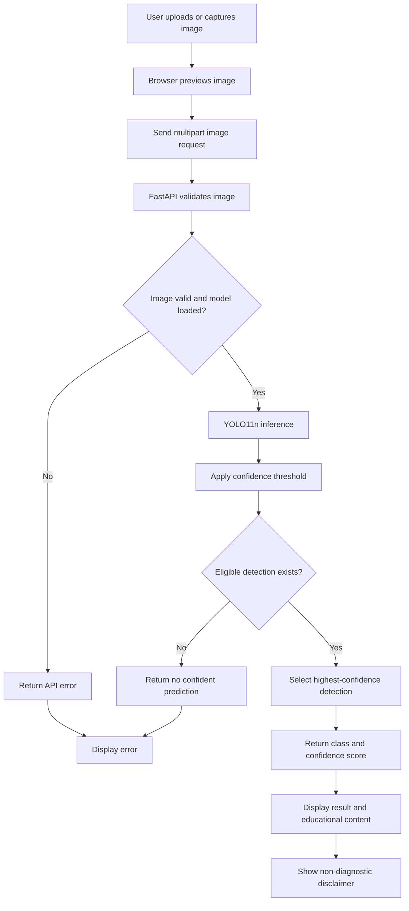
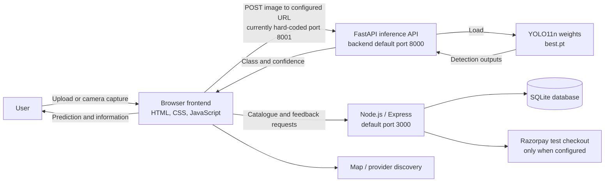

# AI-Based Skin Disease Detection and Educational Recommendation System Using YOLO11n

**Author(s):** [Add author name(s)]  
**Affiliation(s):** [Add department, institution, city, country]  
**Corresponding author:** [Add email, if required]

> **Draft status:** This is a research-paper draft based on the project files reviewed. It is not an IEEE-approved or publication-ready manuscript. The supplied metrics numerically correspond approximately to one validation row in the training log, but that does not establish that the metrics were calculated from the saved `best.pt` weights. The log records results through epoch 50, whereas the project description states 46 epochs. No test-set evaluation was found in the reviewed records.

## Abstract

This paper describes a web-based skin-image analysis and educational information prototype that uses a trained YOLO11n object-detection model. The model is configured for seven categories: acne, eczema, leprosy, melasma, psoriasis, ringworm, and warts. Users can upload an image or capture one using a browser camera. The frontend submits the image to a Python FastAPI service, which applies the trained model and returns the highest-confidence detection above a configured threshold. The interface displays the predicted class and score, along with educational content and a notice that the result is not a medical diagnosis. Supporting modules provide general disease information, diet and wellness content, healthcare-provider discovery, a demo skincare catalogue, and feedback submission. The project reports precision 0.622, recall 0.428, mAP@50 0.469, and mAP@50-95 0.274. These values approximately match a validation row at epoch 35 in the available log; they are not test-set results and do not demonstrate clinical validity. The training records extend through epoch 50, which conflicts with the supplied statement that training stopped at epoch 46. A held-out test evaluation, checkpoint provenance, and the training-run history must be confirmed before performance claims are finalized. Model confidence is a model score, not medical certainty.

**Index Terms—** Skin image analysis, object detection, YOLO11n, computer vision, FastAPI, educational health application.

## INTRODUCTION

Computer-vision methods have been investigated for automated analysis of dermatological images, including deep-learning systems for skin-cancer classification [1] and benchmark efforts for skin-lesion analysis [2], [3]. Such studies provide context for image-based analysis but do not establish that a model trained on a different dataset or label scheme generalizes to other skin conditions, image sources, or clinical populations.

This project implements a web application integrating a seven-class image detector and educational modules. The detector uses YOLO11n through the Ultralytics software framework [4]. The browser interface allows a user to upload an image or capture one using a camera and displays a predicted class and confidence score. General disease information is available alongside the prediction, and the application advises users to seek professional medical advice.

The work is presented as an engineering prototype. It does not claim clinical utility, provide a medical diagnosis or treatment plan, or establish superiority over other models. The reported detection metrics and implementation details are described with their validation and reproducibility limitations.

## BACKGROUND AND MOTIVATION

The project addresses the software-engineering problem of connecting a trained image detector to a browser-based user interface while communicating model output cautiously. The detector is configured for acne, eczema, leprosy, melasma, psoriasis, ringworm, and warts. It can produce multiple candidate detections for an image; the backend discards detections below its configured confidence threshold and returns the remaining detection with the highest confidence. The application therefore presents one predicted category rather than a complete list of detections.

The application also groups general informational modules in one interface. The education and diet sections provide general content; the provider page supports location- or place-based discovery; and the product catalogue is identified in the interface as demo content. These features do not constitute individualized care, clinician consultation, or a clinically validated recommendation pathway.

The confidence score is the model's score for a detection. It is not established as a calibrated probability that the user has the corresponding disease, a measure of severity, or medical certainty. The result must not be interpreted as a diagnosis.

## LITERATURE SURVEY

Esteva *et al.* reported a deep neural network for skin-cancer classification and compared its performance with dermatologists for specified classification tasks [1]. This work demonstrates research into image-based dermatological classification; it is not a direct performance baseline for the present seven-class YOLO object detector.

Tschandl *et al.* introduced HAM10000, a dataset of 10,015 dermatoscopic images of pigmented lesions [2]. Its image source and label categories are distinct from the Ultralytics-attributed dataset described in this project. It is relevant as an example of documented dataset construction and diversity, not as the training dataset used here. Codella *et al.* described a skin-lesion analysis challenge at the 2017 International Symposium on Biomedical Imaging [3], illustrating the role of defined benchmarks in comparing image-analysis methods.

The present project uses YOLO11n through the Ultralytics implementation [4]. No peer-reviewed YOLO11 paper or project-specific comparative experiment was verified for this draft. Accordingly, the model is described using its implementation name and project configuration; no novelty or superiority claim is made. The official Ultralytics validation documentation describes validation options, including dataset split selection [5].

The papers cited above concern skin cancer or pigmented-lesion analysis and are not equivalent to detecting the seven labels used in this project. Their results must not be compared numerically with this project unless datasets, labels, split design, metrics, and evaluation protocols are made comparable.

## PROPOSED METHODOLOGY

### Image inference workflow

1. The user selects an image file or captures an image with the browser camera.
2. The frontend previews the image and converts the image data to a file.
3. The browser sends the image as multipart form data to the FastAPI `/predict` route.
4. The backend checks the filename extension and MIME type, checks the configured maximum upload size, and verifies that the file contains a decodable image.
5. The loaded YOLO model runs inference using the configured confidence threshold. The backend default is 0.25.
6. Detections below the threshold are ignored. If none remain, the API returns a no-confident-prediction response. Otherwise, it selects the highest-confidence detection and returns its class identifier, class name, and confidence as a percentage.
7. The frontend displays the predicted class, confidence score, related educational information when available, and the medical disclaimer.

The backend loads the configured model at startup. Its default model path is `runs/detect/runs/skin_disease_model/weights/best.pt`, resolved relative to the project root; the path can be overridden with the `MODEL_PATH` environment variable. The reviewed project contains `best.pt` and `last.pt` under the run's `weights` directory.

The confidence threshold used by the web prediction endpoint should not be conflated with the confidence handling used to calculate mAP during validation. The chosen validation and inference parameters must be recorded separately when the experiment is reproduced.

### Training configuration and model

The project training script initializes from `yolo11n.pt` when no resumable `last.pt` checkpoint is found. If `last.pt` is present, it calls training in resume mode. The saved run configuration records a maximum of 50 epochs, patience 100, image size 640, batch size 8, AdamW optimizer, pretrained initialization, validation on the `val` split, automatic mixed precision, seed 0, deterministic mode, and an IoU setting of 0.7. The trained weights are stored as `best.pt` and `last.pt`.

The project uses YOLO11n as an object detector [4]. A detailed layer-by-layer architecture, parameter count, and computation estimate are not included because a verified summary of the exact checkpoint was not available. Such details should be generated from the actual `best.pt` and checked against the relevant official model documentation before inclusion.

**Fig. 1. Image-inference workflow.** The Mermaid source is editable; redraw or export as a vector figure for an IEEE conference template.



## DATASET DESCRIPTION

The local dataset configuration file defines `train`, `val`, and `test` image directories and lists the seven classes. The project description attributes the dataset to Ultralytics. The reviewed configuration does not contain the exact dataset release, original dataset URL, formal citation, license, or annotation protocol; these must be confirmed before publication.

The following image and label-file counts were counted in the project directories. Per-class counts are annotated object instances counted from YOLO label files; an image can have multiple instances and contribute to more than one class.

**TABLE I**  
**DATASET SPLIT COUNTS**

| Split | Images | Label files |
|---|---:|---:|
| Training | 1,539 | 1,539 |
| Validation | 291 | 291 |
| Test | 148 | 148 |
| **Total** | **1,978** | **1,978** |

**TABLE II**  
**ANNOTATED OBJECT INSTANCES BY CLASS**

| Class | Training | Validation | Test |
|---|---:|---:|---:|
| Acne | 786 | 80 | 83 |
| Eczema | 669 | 282 | 68 |
| Leprosy | 363 | 66 | 50 |
| Melasma | 559 | 151 | 81 |
| Psoriasis | 854 | 225 | 89 |
| Ringworm | 231 | 49 | 94 |
| Warts | 477 | 112 | 54 |
| **Total instances** | **3,939** | **965** | **519** |

Class frequencies vary across splits. These counts alone do not establish patient-level independence, demographic coverage, acquisition diversity, representativeness, or annotation quality. These properties must not be assumed from the directory structure.

## EXPERIMENTAL SETUP

The available `args.yaml` records a detection training run configured for up to 50 epochs with patience 100, 640-pixel images, batch size 8, AdamW, pretrained initialization, automatic mixed precision, seed 0, and deterministic training. Validation is configured on `val`. The run's `results.csv` has metric rows through epoch 50 and includes a repeated row labelled epoch 3. The training script can resume from `last.pt`.

The project description supplied for this paper says that training stopped after 46 epochs due to early stopping. This conflicts with the run configuration and saved log, which specify 50 as the epoch limit and contain results through epoch 50. These records do not establish which run produced the deployed checkpoint or whether a separate 46-epoch run exists. This discrepancy is left unresolved rather than inferred.

The exact GPU/CPU hardware, operating system, Python version, PyTorch version, Ultralytics version, training duration, inference latency, and model summary were not established by the reviewed project files. The backend dependency file does not pin exact versions. These details are needed for reproducibility.

### Test-split evaluation procedure

No test-split metrics were present in the reviewed log. The local dataset configuration defines a `test` split, so a separate evaluation of the trained `best.pt` checkpoint is needed before reporting test performance. From the project root, in the Python environment containing the same intended Ultralytics installation, run the following validation command [5]:

```powershell
yolo detect val model="C:\Users\chetu\OneDrive\Desktop\Skin project\runs\detect\runs\skin_disease_model\weights\best.pt" data="C:\Users\chetu\OneDrive\Desktop\Skin project\skin-disease\data.yaml" split=test imgsz=640 batch=8 conf=0.001 iou=0.7 project="runs/detect" name="skin_disease_test"
```

This command requests validation against the dataset's `test` split; it is a procedure to run, not a result reported in this paper. Record the command, exact Ultralytics version, selected checkpoint, all evaluation parameters, and the generated metrics/artifacts. Keep this test evaluation separate from checkpoint selection and model tuning. Do not copy the existing validation metrics into the test-results table. Confirm the validation tool version and supported argument syntax in the installed environment before execution.

## RESULTS AND ANALYSIS

The project reports precision 0.622, recall 0.428, mAP@50 0.469, and mAP@50-95 0.274. The available `results.csv` includes a row labelled epoch 35 with precision 0.62287, recall 0.42828, mAP@50 0.46982, and mAP@50-95 0.27442. Thus, the supplied values approximately correspond to that validation row; the reported decimal values do not all follow conventional rounding to three places. Confirm the intended reported precision and rounding method.

**TABLE III**  
**PROJECT-REPORTED METRICS; TEST PERFORMANCE NOT REPORTED**

| Metric | Supplied value | Provenance indicated by available record |
|---|---:|---|
| Precision | 0.622 | Approximately matches epoch-35 validation row |
| Recall | 0.428 | Approximately matches epoch-35 validation row |
| mAP@50 | 0.469 | Approximately matches epoch-35 validation row |
| mAP@50-95 | 0.274 | Approximately matches epoch-35 validation row |

The log match identifies a numerically similar validation row; it does not prove that the supplied values were evaluated using `best.pt`, nor does it establish the exact metric-reporting procedure. Until the model artifact and evaluation record are tied together, describe these only as project-reported metrics that correspond approximately to a validation row.

Precision describes the proportion of predicted detections judged correct under the evaluation matching protocol; it is not accuracy. Recall describes the proportion of ground-truth objects detected. mAP@50 summarizes average precision at IoU 0.50, while mAP@50-95 averages over IoU thresholds from 0.50 to 0.95 in increments of 0.05. The project metrics indicate incomplete detection performance under the reported protocol. They do not by themselves show how performance varies by class, image source, or user population, and they do not establish diagnostic utility.

The `test` directory contains 148 images and corresponding labels, but no test metrics were found. No test result, comparison baseline, clinical validation, confidence interval, or independent external evaluation is claimed. The 46-versus-50 epoch discrepancy, epoch-35 metric correspondence, and exact `best.pt` provenance remain unresolved.

### Limitations

1. The supplied metrics are modest detection metrics and include recall of 0.428; missed objects are a material limitation.
2. The metrics align approximately with a validation row, not a documented held-out test result. Their association with the saved `best.pt` has not been demonstrated.
3. Class-instance frequencies vary across the splits, and dataset representativeness and patient-level separation are unknown.
4. The backend returns only the highest-confidence detection and does not display the detection boxes.
5. A model confidence score is not medical certainty and no calibration study was identified.
6. No clinician review, prospective evaluation, external validation, or assessment of healthcare impact is documented.
7. Educational and wellness content is general and is not demonstrated to be individualized or clinically reviewed.
8. Login is a simulated client-side flow in the reviewed JavaScript, not backend authentication. Registration, social login, and password recovery are presented as future functionality. Product content is demo data and checkout is test-mode code.
9. Software versions, hardware, runtime, dataset provenance, checkpoint provenance, and the training-duration discrepancy require confirmation.

## SYSTEM ARCHITECTURE

The reviewed project has a browser frontend, a Python inference backend, and a separate Node.js/Express service.

**Frontend:** HTML, CSS, and JavaScript pages implement the login screen, dashboard, disease information, diet and wellness information, provider discovery, product catalogue, and feedback form. The dashboard supports image upload and browser camera capture. It displays the class name, confidence score, educational information, and disclaimer.

**Inference backend:** `backend/main.py` defines a FastAPI application with `/health` and `/predict` endpoints. At startup it loads the model from the configured `MODEL_PATH`, defaulting to `runs/detect/runs/skin_disease_model/weights/best.pt`. The prediction endpoint validates image uploads, runs YOLO inference, filters boxes below the configured threshold, and returns the highest-confidence remaining class or a no-confident-prediction response.

**Supporting backend:** `server.js` defines an Express service. The default port is 3000. It provides catalogue and feedback routes, persists feedback and order records in a local SQLite database, and contains optional Razorpay test-checkout logic.

**Implemented-feature boundaries:** Image prediction and the information pages are implemented. Login uses a simulated client-side flow. Registration, social login, and password recovery are not implemented in the reviewed login script. The provider page provides place discovery rather than remote consultation. The catalogue labels its product data as demo content; checkout is test-mode functionality.

**Frontend/backend port discrepancy:** The dashboard JavaScript makes its prediction request to the hard-coded URL `http://127.0.0.1:8001/predict`. In contrast, `backend/main.py` starts Uvicorn on port 8000, and `backend/README.md` documents the API at `http://127.0.0.1:8000`. No configuration resolving this discrepancy was verified. The deployment must either run the backend at the frontend's configured port or change configuration/code; this paper does not claim that the discrepancy is fixed.

**Fig. 2. System architecture.** The Mermaid diagram is an editable draft; redraw or export it as a vector image when transferring the paper to an IEEE conference template.



The diagram identifies the two different port values present in the source and documentation; it does not represent a confirmed working connection between the browser and the API.

## CONCLUSION

This paper documents a web-based prototype that combines a YOLO11n detector configured for seven skin-disease categories with an HTML/CSS/JavaScript frontend, FastAPI inference endpoint, and educational modules. The backend selects the highest-confidence detection above its configured threshold and returns a class and score. The application explicitly frames results as informational and directs users to professional medical advice.

The supplied precision (0.622), recall (0.428), mAP@50 (0.469), and mAP@50-95 (0.274) approximately match an epoch-35 validation record. They are not verified test results and do not establish clinical validity or medical certainty. The log continues through epoch 50 despite a supplied description of training ending at epoch 46; this discrepancy and the checkpoint associated with the metrics remain to be resolved.

Before drawing further conclusions, evaluate the frozen `best.pt` checkpoint on the configured test split, retain the resulting run artifacts, document the software and hardware environment, report per-class performance, and verify dataset and checkpoint provenance. External validation and appropriate clinical review would be necessary before considering any clinical application. The existing product, account, and provider-discovery features should continue to be described within their demo and information-only limits.

## REFERENCES

[1] A. Esteva, B. Kuprel, R. A. Novoa, J. Ko, S. M. Swetter, H. M. Blau, and S. Thrun, “Dermatologist-level classification of skin cancer with deep neural networks,” *Nature*, vol. 542, no. 7639, pp. 115–118, 2017, doi: [10.1038/nature21056](https://doi.org/10.1038/nature21056).

[2] P. Tschandl, C. Rosendahl, and H. Kittler, “The HAM10000 dataset, a large collection of multi-source dermatoscopic images of common pigmented skin lesions,” *Scientific Data*, vol. 5, Art. no. 180161, 2018, doi: [10.1038/sdata.2018.161](https://doi.org/10.1038/sdata.2018.161).

[3] N. C. F. Codella *et al*., “Skin lesion analysis toward melanoma detection: A challenge at the 2017 International Symposium on Biomedical Imaging (ISBI), hosted by the International Skin Imaging Collaboration (ISIC),” in *Proc. IEEE 15th Int. Symp. Biomed. Imaging (ISBI)*, 2018, pp. 168–172, doi: [10.1109/ISBI.2018.8363547](https://doi.org/10.1109/ISBI.2018.8363547).

[4] Ultralytics, “YOLO11,” *Ultralytics Documentation*. [Online]. Available: https://docs.ultralytics.com/models/yolo11/. [Accessed: Oct. 12, 2026].

[5] Ultralytics, “Model Validation with Ultralytics YOLO,” *Ultralytics Documentation*. [Online]. Available: https://docs.ultralytics.com/modes/val/. [Accessed: Oct. 12, 2026].

**Reference verification note:** The bibliographic details for [1]–[3] were checked against Crossref records for their DOIs. References [4] and [5] are official, maintained Ultralytics documentation pages, not peer-reviewed papers. Reference [2] describes HAM10000 and is not the dataset identified in this project. The exact source, release, and citation for the project dataset remain unverified.
