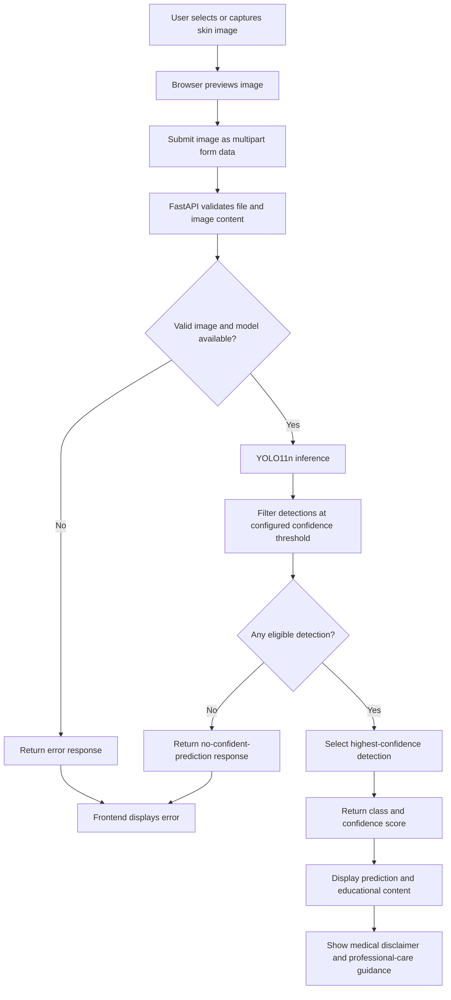
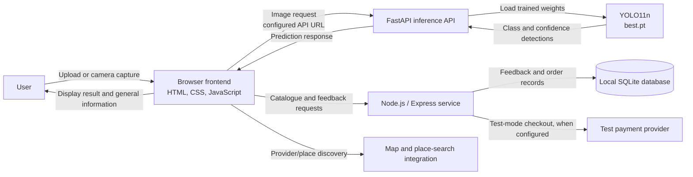

# AI-Based Skin Disease Detection and Educational Recommendation System Using YOLO11n

**Author(s):** [Add author name(s)]  
**Affiliation(s):** [Add department, institution, city, country]  
**Corresponding author:** [Add email, if required by the conference]

> **Draft status:** This draft reflects the supplied project description and the implementation files reviewed. The supplied metrics correspond approximately to the validation results recorded at epoch 35; their stated values appear truncated rather than conventionally rounded to three decimal places. The training log contains results through epoch 50, which conflicts with the supplied statement that training stopped at epoch 46. No reported evaluation on the configured test split was found. Confirm these points before submission.

## Abstract

This paper presents a web-based skin disease image analysis and educational information system using a fine-tuned YOLO11n object-detection model. The model is configured to identify seven classes: acne, eczema, leprosy, melasma, psoriasis, ringworm, and warts. Users can upload an image or capture one through a browser camera interface. The frontend submits the image to a Python FastAPI backend, which applies the trained model and returns the highest-confidence detection that satisfies a configured threshold. The application also provides educational information and separate modules for wellness content, healthcare-provider discovery, skincare product browsing, and feedback. The reported evaluation metrics are precision 0.622, recall 0.428, mAP@50 0.469, and mAP@50-95 0.274. These values correspond approximately to an epoch-35 validation record and are not evidence of clinical validity or test-set performance. The system is intended for informational and educational use; it does not provide medical diagnosis or treatment. Model confidence is a model score, not medical certainty. Further test-set evaluation, external validation, and verification of the training-run history are required.

**Index Terms—** Skin disease image analysis, object detection, YOLO11n, computer vision, FastAPI, educational health application, web application.

## INTRODUCTION

Skin conditions can have visually similar appearances, and people may not know which source of information or healthcare professional to consult. Image-analysis software can help explore visual patterns, but an automated prediction from an image is not a substitute for examination by a qualified healthcare professional. The usefulness of an image model depends on its training data, evaluation design, operating threshold, and performance on images that differ from those used during development.

This project implements a web application combining a seven-class skin-image detector with educational and supporting information modules. The detector uses YOLO11n through the Ultralytics framework and is exposed to the browser through a FastAPI prediction endpoint. A user can upload an image or capture one using the browser camera; the application displays a predicted class, confidence score, and related educational content with a professional-care disclaimer.

The contribution is an integrated engineering prototype and its reported model evaluation, not a claim of clinical utility or superiority over other models. The available project files contain no verified comparison experiment against other detection models.

## BACKGROUND AND MOTIVATION

The engineering problem addressed is how to connect an image-based object detector to an accessible web interface while presenting its output responsibly. The detector is configured for acne, eczema, leprosy, melasma, psoriasis, ringworm, and warts. Given an image, the model may return multiple detections. The backend filters detections using a confidence threshold and selects the highest-confidence remaining detection for display. This reduces the response to one displayed class but does not establish that the prediction is medically correct.

The application is motivated by the potential to make general skin-condition information and provider-discovery features accessible through a single interface. Its educational, wellness, and product content is general and does not constitute individualized medical advice. A confidence score indicates the model’s score for a detection; it is not a calibrated probability that a person has a disease, a measure of severity, or medical certainty.

## LITERATURE SURVEY

Relevant scholarship for a final version should cover (i) machine-learning analysis of dermatological images, (ii) object detection and classification for medical imagery, (iii) dataset representativeness and external validation of skin-image models, and (iv) the YOLO11 model family and the exact software implementation used.

**Verified citations are still required.** No scholarly bibliographic records were supplied with the project files or verified for this draft. Before submission, identify and verify primary sources for prior skin-image systems, YOLO11, dataset provenance, evaluation metrics, and any clinical claims. Check the authors, exact title, venue, year, pages or article number, and DOI or stable URL for every reference. Do not insert numbered citations until the corresponding references have been verified. No numerical comparison with other models is made because no comparable experiment is documented.

## PROPOSED METHODOLOGY

### End-to-End Inference Workflow

1. The user selects an image file or captures an image through the browser camera interface.
2. The frontend previews the selected image and converts the image data to a file for submission.
3. The frontend sends the image as multipart form data to the FastAPI `/predict` endpoint.
4. The backend checks the file extension and MIME type, applies a configurable maximum upload size, and verifies that the content can be decoded as an image.
5. The backend invokes the loaded YOLO model with a configurable confidence threshold. The default threshold in the reviewed backend is 0.25.
6. Detections below the threshold are discarded. If none remain, the API returns a no-confident-prediction response. Otherwise, it returns the class identifier, class name, and confidence percentage for the highest-confidence detection.
7. The frontend displays the predicted class and score, along with available educational information and a disclaimer recommending professional advice.

The dashboard labels the output as an AI-generated prediction for informational purposes and states that it is not a medical diagnosis. The application does not determine a treatment plan from the prediction.

**Fig. 1. Image analysis workflow (editable Mermaid source).** Redraw as a vector figure when transferring the paper to the IEEE template.

### YOLO11n Model

The training script initializes from `yolo11n.pt` when no resumable checkpoint is found and resumes from `last.pt` when that checkpoint exists. The trained weights are saved as `best.pt`, which the backend loads by default. YOLO performs object detection by producing candidate locations, classes, and confidence scores. The backend uses the class and confidence, selects one eligible detection, and does not return a bounding box for display.

Detailed layer counts, parameter totals, and internal block descriptions are omitted because a verified model summary for the exact checkpoint was not available. A final architecture description should cite a verified technical source and use a summary generated from the project’s `best.pt` if model size is reported.

## DATASET DESCRIPTION

The project contains a YOLO-format dataset configuration with separate training, validation, and test image directories. The project description attributes the dataset to Ultralytics. The reviewed configuration identifies the seven classes but does not record the exact dataset release, formal citation, license, or original source URL.

Image and label-file counts were counted from the local project directories. Class-instance counts below were obtained by counting class identifiers in the label files. A single image can contain more than one annotated object, so class image counts may overlap.

**TABLE I**  
**DATASET SPLIT SIZES**

| Split | Images | Label files |
|---|---:|---:|
| Training | 1,539 | 1,539 |
| Validation | 291 | 291 |
| Test | 148 | 148 |
| **Total** | **1,978** | **1,978** |

**TABLE II**  
**ANNOTATED INSTANCES BY CLASS AND SPLIT**

| Class | Training | Validation | Test |
|---|---:|---:|---:|
| Acne | 786 | 80 | 83 |
| Eczema | 669 | 282 | 68 |
| Leprosy | 363 | 66 | 50 |
| Melasma | 559 | 151 | 81 |
| Psoriasis | 854 | 225 | 89 |
| Ringworm | 231 | 49 | 94 |
| Warts | 477 | 112 | 54 |
| **Total instances** | **3,939** | **965** | **519** |

Instance counts vary by class and split, motivating per-class evaluation and further analysis of class imbalance. The reviewed files do not establish patient-level independence across splits, demographic representation, image-acquisition diversity, annotation protocol, or dataset representativeness.

## EXPERIMENTAL SETUP

The reviewed training configuration specifies image size 640, batch size 8, a maximum of 50 epochs, AdamW optimization, pretrained initialization, validation on the `val` split, automatic mixed precision, seed 0, and deterministic training. The training script resumes from `last.pt` when available. The backend loads `best.pt` and uses a default inference confidence threshold of 0.25, configurable through an environment variable.

The saved run configuration specifies `epochs: 50` and `patience: 100`; its results file contains rows through epoch 50. These artifacts do not substantiate the separate project statement that training stopped at epoch 46 due to early stopping. Hardware, operating system, Python and PyTorch versions, exact Ultralytics version, training/inference time, and a model summary were not established by the reviewed materials. The project dependency files do not pin package versions.

## RESULTS AND ANALYSIS

The supplied values correspond approximately to the epoch-35 validation row in the project’s training-results CSV: precision 0.62287, recall 0.42828, mAP@50 0.46982, and mAP@50-95 0.27442. The values supplied for the paper appear truncated rather than conventionally rounded to three decimal places; confirm the intended precision and rounding method.

**TABLE III**  
**REPORTED EVALUATION METRICS**

| Metric | Reported value |
|---|---:|
| Precision | 0.622 |
| Recall | 0.428 |
| mAP@50 | 0.469 |
| mAP@50-95 | 0.274 |

Precision is the proportion of predicted detections that are correct under the evaluation matching criteria; it must not be described as accuracy. Recall measures the proportion of ground-truth objects detected. mAP@50 summarizes average precision at an intersection-over-union (IoU) threshold of 0.50. mAP@50-95 averages across IoU thresholds from 0.50 to 0.95 in 0.05 increments.

The reported precision exceeds recall, indicating that some ground-truth objects were missed under the evaluation protocol, while some predictions were correct. The lower mAP@50-95 relative to mAP@50 is consistent with stricter localization requirements at higher IoU thresholds. These metrics are an initial measure of object-detection performance; they do not establish clinical validity, diagnosis, or medical risk. Per-class precision/recall/AP, confidence intervals, threshold-sensitivity analysis, and a comparison against baselines were not available in the reviewed records.

The configured test split contains 148 images, but the matching metrics are present in the validation log. Unless a separate held-out test evaluation is produced, these results should be identified as validation metrics. The recorded 50-epoch run conflicts with the supplied 46-epoch early-stopping statement, and the exact checkpoint-selection and training-stop history should be confirmed.

### Limitations

1. The reported metrics—precision 0.622, recall 0.428, mAP@50 0.469, and mAP@50-95 0.274—show that detections can be missed and localization performance declines under stricter IoU evaluation.
2. No test-split or external-validation metrics were found in the reviewed artifacts.
3. Dataset class-instance counts vary. Patient-level independence, demographics, acquisition diversity, annotation protocol, and licensing are unverified.
4. The backend displays only the highest-confidence eligible detection; it does not display other detections or bounding boxes.
5. Confidence is not calibrated as a probability and is not medical certainty. No calibration or threshold-sensitivity study was documented.
6. No clinician evaluation, prospective study, or impact assessment is documented. The prototype is not a diagnostic or treatment system.
7. Educational, diet, and wellness content is not established as individualized or clinically reviewed.
8. Login is simulated in the reviewed client code. Registration and password recovery are not implemented. Product content and checkout are demo/test functionality.
9. Reproducibility details, checkpoint provenance, software versions, hardware, runtime, and the training-duration discrepancy remain to be resolved.

## SYSTEM ARCHITECTURE

The prototype comprises a browser frontend, a Python inference service, and a supporting Node.js service.

**Frontend:** HTML, CSS, and JavaScript pages provide login, dashboard, disease information, diet and wellness content, doctor/clinic search, product catalogue, and feedback. The dashboard accepts uploads or browser-camera captures and displays the predicted class, confidence score, educational content, and medical disclaimer.

**Inference backend:** FastAPI loads `best.pt` at startup and exposes `/health` and `/predict`. The prediction endpoint validates image inputs, invokes YOLO inference, filters detections, and returns either the highest-confidence valid prediction or a no-confident-prediction response.

**Supporting service:** Node.js/Express serves product-catalogue and feedback operations and contains test-mode checkout functionality. Feedback is stored in a local SQLite database. Catalogue names, images, and prices are identified as demo content; test-mode checkout does not establish a production order or payment workflow.

**Information and discovery modules:** The education and diet pages present general information. The doctor-consultation page supports location- or place-based provider discovery; it is not a remote consultation with a clinician. Product content does not establish that an item is suitable for a predicted condition.

**Feature status:** Image upload/camera capture, prediction, educational information, wellness content, provider discovery, demo product browsing, and feedback submission are represented in the reviewed files. Login is a simulated client-side flow, not backend authentication. Registration, social login, and password recovery are not implemented. Checkout is test-mode only.

**Deployment detail requiring confirmation:** The frontend prediction script calls `http://127.0.0.1:8001/predict`, whereas the backend startup code and README specify port 8000 by default. Confirm the actual development/deployment configuration before describing a single deployed endpoint.

**Fig. 2. Prototype system architecture (editable Mermaid source).** Redraw as a vector figure when transferring the paper to the IEEE template.

The provider/place-search and test-payment connections represent supporting integrations exposed by the application, not part of the image-inference path. The prediction URL and backend port require confirmation as described above.

## CONCLUSION

This paper describes a web-based prototype integrating YOLO11n inference for seven skin-disease categories with a browser interface and supporting educational modules. Users can upload or capture an image, submit it to a FastAPI service, and view the highest-confidence eligible prediction with a confidence score and disclaimer. The project reports precision 0.622, recall 0.428, mAP@50 0.469, and mAP@50-95 0.274. These values correspond approximately to an epoch-35 validation record and must not be interpreted as clinical accuracy or test-set performance.

Future work should resolve checkpoint and training-run provenance, evaluate a frozen model on the configured test split, report per-class performance and uncertainty, and assess external datasets and varied acquisition conditions. Calibration and threshold selection should be studied, and dataset labels and educational content should receive appropriate expert review. Any consideration of clinical use would require suitable clinical evaluation, governance, and regulatory review. Production authentication, verified provider information, and non-demo commerce workflows also remain future engineering work.

## REFERENCES

No verified bibliographic references were available in the reviewed project files. Add and verify sources before submission for:

- The YOLO11 model family and the exact Ultralytics implementation/version used.
- The original dataset publication or official record, exact release/version, and license.
- Peer-reviewed skin-image analysis studies relevant to the seven classes and their evaluation limitations.
- Object-detection evaluation metrics, if definitions beyond standard terminology are included.
- Authoritative clinical sources for any disease education or care guidance retained in the paper.

For each source, verify authors, exact title, publication venue, year, pages or article number, and DOI or stable URL. Add IEEE numbered citations such as [1] only after the references are verified. No authors, titles, DOIs, publication details, or URLs have been fabricated in this draft.

**Information to confirm before submission (editorial checklist, not a paper section):**

1. Confirm the discrepancy between the supplied 46-epoch early-stopping statement and the reviewed configuration/log showing 50 epochs and results through epoch 50.
2. Confirm whether the supplied metrics are validation results, the intended decimal precision/rounding, and the checkpoint-selection rule. Run a test-split evaluation before claiming test performance.
3. Provide the dataset source/release, version, retrieval date, license, annotation protocol, and split-independence details.
4. Record hardware, operating system, Python, PyTorch, Ultralytics and other relevant package versions, and training/inference timing.
5. Document the evaluation checkpoint, confidence and IoU thresholds, NMS settings, per-class results, and uncertainty estimates.
6. Provide a model summary for `best.pt` if reporting parameter count, computation estimate, or detailed architecture.
7. Resolve the frontend port 8001 versus backend default port 8000 and confirm which features should be represented as implemented.
8. Add author names, affiliations, corresponding-author details, and verified references.
